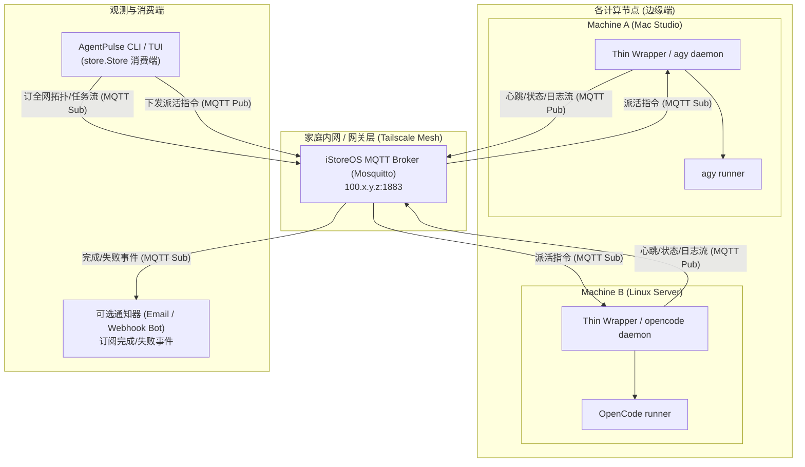
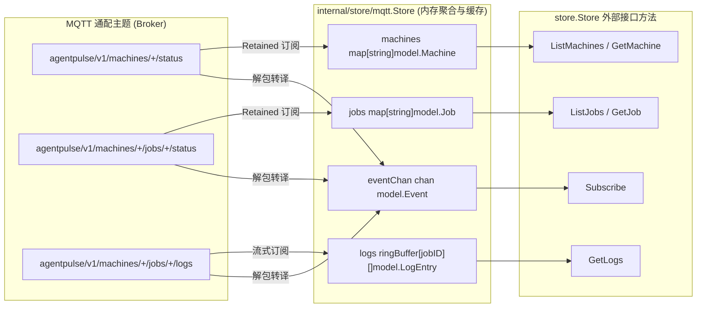

# AgentPulse MQTT 协议设计规范 (v1)

> **状态**：协议规范已落于 `internal/store/mqtt` (Store 实现已落，Wrapper/Dispatch 后续演进)  
> **适用版本**：AgentPulse CLI v0.2+  
> **目标对齐**：`internal/model` 数据模型与 `internal/store.Store` 接口抽象

---

## 1. 概述与设计背景

AgentPulse 是一个专注于**跨机监控与任务分发**的轻量级 CLI 工具。在个人分布式开发与实验环境中，开发者常常在多台机器（如本地 Mac Studio、家庭服务器、远程 Linux GPU 训练机）上运行自主编程 Agent（如 `agy` 与 `OpenCode`）。

为了实现跨主机的统一观测与远程派活，AgentPulse 采用**中心化 Broker + 边缘薄 Wrapper**的星型网络模型：
1. **边缘薄 Wrapper**：运行在各工作机器上的极轻守护进程或命令封装器，负责捕获目标 Agent 的进程生命周期与控制台流式日志，并定时向 MQTT Broker 汇报节点心跳与 Job 状态。
2. **中心 MQTT Broker**：部署在家庭网关/路由（如 iStoreOS 路由器的 Mosquitto 软件包），所有跨机通信依托安全私网（如 Tailscale）互联。
3. **调度与监控终端（CLI / TUI）**：谁派活，谁订阅主题盯进度；开发者可在任一接入 Tailscale 的节点运行 `agentpulse` 实时查阅全网拓扑、作业进度与日志。
4. **通知集成**：支持订阅完成/失败事件并触发可选邮件通知（如任务耗时极长的训练或自动重构任务结束时告警）。

### 1.1 系统拓扑架构



---

## 2. 明确非目标 (Non-Goals)

为了保持 AgentPulse 的极简、专注与高稳定性，本协议与实现明确将以下内容列为非目标：

1. **不做 Web / GUI 前端服务**：
   - 坚持纯终端优先路线，前端交互完全由 Go + Bubble Tea TUI 与终端子命令支撑；不引入 Node.js、React、Electron 或复杂的前后端通信链路。
2. **不内嵌 MQTT Broker**：
   - CLI 与 Wrapper 仅作为纯 MQTT 客户端，不在 CLI 进程内部启动嵌入式 Broker（如 Go 版 MQTT server）。MQTT 服务依托用户现有的外部基础设施（如家庭 iStoreOS 软路由中的 Mosquitto 服务），保证各客户端退出时不影响消息中枢的持续运行。
3. **不侵入与替代底层模型层**：
   - AgentPulse 仅负责观测外层进程生命周期、重定向控制台 I/O 流与远程调度触发，不侵入、不修改、不替代 `agy` 或 `OpenCode` 内置的模型推理逻辑、Prompt 构建流与 Tool Calling 执行层。

---

## 3. MQTT 规范约定与主题命名空间

### 3.1 基础约定

- **根前缀**：所有主题必须以 `agentpulse/v1/` 开头，支持未来协议版本演进隔离。
- **编码格式**：所有消息体 Payload 一律采用 UTF-8 编码的 JSON 字符串。
- **时间格式**：时间戳字段一律遵循 RFC 3339 纳秒/微秒标准（如 `2026-11-02T13:30:00Z`）。
- **标识符约定**：
  - `{machine_id}`：机器全局唯一标识符，建议由小写字母、数字和连字符组成（例如：`mac-studio-m2`、`homelab-nas`、`gpu-worker-01`）。
  - `{job_id}`：作业全局唯一标识符，格式建议为 `job-YYYYMMDD-短哈希` 或标准 UUID。

### 3.2 QoS 与 Retained 策略原则

| 业务类型 | 对应主题模式 | QoS 等级 | Retained | 设计理由 |
| :--- | :--- | :--- | :--- | :--- |
| **节点心跳/在线状态** | `agentpulse/v1/machines/{machine_id}/status` | **QoS 1** | **true** | 保持最新在线凭据与元数据；掉线时配合遗嘱消息（LWT）自动覆写为离线，后入网客户端可立即可见节点拓扑。 |
| **作业状态变更** | `agentpulse/v1/machines/{machine_id}/jobs/{job_id}/status` | **QoS 1** | **true** | 保证作业的最新生命周期状态持久暂存于 Broker，新接入的 CLI 终端无须等待广播即可完整恢复当前活跃作业面板。 |
| **控制台实时日志流** | `agentpulse/v1/machines/{machine_id}/jobs/{job_id}/logs` | **QoS 0** | **false** | 日志为高频流式数据，追求低延迟与吞吐，避免 QoS 1 握手与 Retained 缓存对 Broker 内存造成过重负担。 |
| **任务派发 (Command)** | `agentpulse/v1/machines/{machine_id}/commands/dispatch` | **QoS 1** | **false** | 任务指令必须至少送达一次，但绝对不能 Retain，避免客户端/Wrapper 重启后重复消费历史派发命令。 |
| **完成/失败告警通知** | `agentpulse/v1/notifications/alerts` | **QoS 1** | **false** | 供邮件机器人或即时通信 Bot 监听，触发一次性告警推送，无需保留。 |

---

## 4. 核心主题树与消息契约 (Payload Schemas)

所有字段严格对齐 `internal/model` 中的现有结构体定义：
- `EngineType`: `"agy"` | `"opencode"`
- `JobStatus`: `"queued"` | `"running"` | `"done"` | `"failed"`
- `LogLevel`: `"INFO"` | `"WARN"` | `"ERROR"` | `"AGENT"` | `"TOOL"`

---

### 4.1 节点心跳与机器状态 (Node Heartbeat & Machine Status)

- **主题**：`agentpulse/v1/machines/{machine_id}/status`
- **发布者**：各计算节点上的 Thin Wrapper
- **频率**：正常每隔 15 秒上报一次心跳；机器初始化上线时立即发布一条。
- **遗嘱设置 (LWT)**：Thin Wrapper 建立 MQTT 连接时，必须将该主题注册为遗嘱消息（Will Message），`online` 设为 `false`，Retained 设为 `true`，QoS 1。

#### 字段定义 (对齐 `model.Machine`)
| 字段 | 类型 | 说明 |
| :--- | :--- | :--- |
| `id` | string | 机器唯一标识符，与主题中 `{machine_id}` 一致 |
| `name` | string | 人类可读的节点别名（如 `"Studio M2 Max"`） |
| `online` | boolean | 节点是否在线 |
| `last_heartbeat` | string (RFC 3339) | 最近一次心跳时间 |
| `platform` | string | 操作系统与架构（如 `"darwin/arm64"`, `"linux/amd64"`） |
| `ip` | string (可选) | 节点内网/Tailscale IP 地址 |
| `job_count` | integer | 当前节点正在运行或排队中的任务总数 |

#### JSON 示例：节点正常在线心跳
```json
{
  "id": "mac-studio-m2",
  "name": "Mac Studio M2 Max (Workstation)",
  "online": true,
  "last_heartbeat": "2026-11-02T13:30:00Z",
  "platform": "darwin/arm64",
  "ip": "100.98.12.34",
  "job_count": 2
}
```

#### JSON 示例：异常断网遗嘱消息 (Broker LWT 代发)
```json
{
  "id": "mac-studio-m2",
  "name": "Mac Studio M2 Max (Workstation)",
  "online": false,
  "last_heartbeat": "2026-11-02T13:30:45Z",
  "platform": "darwin/arm64",
  "ip": "100.98.12.34",
  "job_count": 0
}
```

---

### 4.2 作业生命周期与状态 (Job State & Lifecycle)

- **主题**：`agentpulse/v1/machines/{machine_id}/jobs/{job_id}/status`
- **发布者**：Thin Wrapper
- **触发时机**：Job 状态跃迁（排队、开始运行、进度刷新、正常完成、异常失败）时实时发布。

#### 字段定义 (对齐 `model.Job`)
| 字段 | 类型 | 说明 |
| :--- | :--- | :--- |
| `id` | string | 任务全局唯一 ID |
| `machine_id` | string | 执行任务的目标机器 ID |
| `engine` | string | AI 引擎类型，可选 `"agy"` 或 `"opencode"` |
| `status` | string | 执行状态，可选 `"queued"`, `"running"`, `"done"`, `"failed"` |
| `progress` | number (float) | 进度百分比，取值范围 `0.0` 至 `100.0` |
| `cwd` | string | 任务在目标机器上的工作目录路径 |
| `command` | string | 派发或执行的原始 CLI 命令与参数 |
| `title` | string | 任务标题或简要工作目标描述 |
| `started_at` | string (RFC 3339) | 任务开始时间戳 |
| `updated_at` | string (RFC 3339) | 状态最近一次更新时间戳 |
| `duration_str` | string (可选) | 当前运行时长人类可读文本（如 `"1m 24s"`） |
| `error` | string (可选) | 失败原因或退出错误信息（当 `status == "failed"` 时提供） |

#### JSON 示例：正在运行中的 Job
```json
{
  "id": "job-20261102-001",
  "machine_id": "mac-studio-m2",
  "engine": "agy",
  "status": "running",
  "progress": 65.5,
  "cwd": "/Users/mayingjie/Repos/agentpulse-cli",
  "command": "agy run --task 'refactor store layer'",
  "title": "Refactor store layer for MQTT integration",
  "started_at": "2026-11-02T13:25:00Z",
  "updated_at": "2026-11-02T13:30:15Z",
  "duration_str": "5m 15s",
  "error": ""
}
```

#### JSON 示例：执行失败的 Job
```json
{
  "id": "job-20261102-002",
  "machine_id": "linux-gpu-box",
  "engine": "opencode",
  "status": "failed",
  "progress": 32.0,
  "cwd": "/home/ubuntu/projects/model-finetune",
  "command": "opencode train --config train.yaml",
  "title": "LoRA Fine-tuning on Llama-3",
  "started_at": "2026-11-02T13:10:00Z",
  "updated_at": "2026-11-02T13:14:32Z",
  "duration_str": "4m 32s",
  "error": "CUDA out of memory: tried to allocate 2.40 GiB (GPU 0; 23.69 GiB total capacity)"
}
```

---

### 4.3 任务控制台日志流 (Task Log Stream)

- **主题**：`agentpulse/v1/machines/{machine_id}/jobs/{job_id}/logs`
- **发布者**：Thin Wrapper
- **触发时机**：捕获到 Agent 输出行时实时发送（支持按行或按微批发送）。

#### 字段定义 (对齐 `model.LogEntry`)
| 字段 | 类型 | 说明 |
| :--- | :--- | :--- |
| `timestamp` | string (RFC 3339) | 日志生成的时间戳 |
| `job_id` | string | 任务 ID |
| `machine_id` | string | 机器 ID |
| `engine` | string | `"agy"` 或 `"opencode"` |
| `level` | string | 日志分类等级：`"INFO"`, `"WARN"`, `"ERROR"`, `"AGENT"`, `"TOOL"` |
| `message` | string | 实际日志内容文本 |
| `seq` | integer (可选) | 日志递增序列号（用于接收端重排与丢包检测） |

#### JSON 示例：Agent 思考日志与工具调用日志
```json
{
  "timestamp": "2026-11-02T13:30:16.124Z",
  "job_id": "job-20261102-001",
  "machine_id": "mac-studio-m2",
  "engine": "agy",
  "level": "AGENT",
  "message": "Analyzing repository structure to verify store.Store interface requirements...",
  "seq": 108
}
```

```json
{
  "timestamp": "2026-11-02T13:30:18.450Z",
  "job_id": "job-20261102-001",
  "machine_id": "mac-studio-m2",
  "engine": "agy",
  "level": "TOOL",
  "message": "Execute tool run_command: git status",
  "seq": 109
}
```

---

### 4.4 派活指令 (Job Dispatch / Command)

- **主题**：`agentpulse/v1/machines/{machine_id}/commands/dispatch`
- **发布者**：调度者 CLI 终端（如 `agentpulse dispatch --machine ...`）
- **订阅者**：对应 `{machine_id}` 上的 Thin Wrapper

#### 字段定义
| 字段 | 类型 | 说明 |
| :--- | :--- | :--- |
| `command_id` | string | 派发指令唯一 UUID |
| `job_id` | string | 预分配的 Job ID |
| `engine` | string | 指定执行引擎：`"agy"` 或 `"opencode"` |
| `cwd` | string | 远程主机的目标执行工作目录 |
| `command` | string | 待调用的可执行命令（如 `"agy"` 或 `"opencode run"`） |
| `args` | array[string] | 命令行附加参数数组 |
| `title` | string | 人类可读的任务描述与摘要 |
| `timeout_seconds` | integer | 最大运行超时秒数（0 表示无限制） |
| `env` | map[string]string | 注入远程执行进程的环境变量 |
| `requested_by` | string | 派活发起者标识（如 `"user@my-laptop"`） |
| `timestamp` | string (RFC 3339) | 指令发起时间戳 |

#### JSON 示例：派活指令
```json
{
  "command_id": "cmd-88ab12-34ef",
  "job_id": "job-20261102-003",
  "engine": "agy",
  "cwd": "/data/workspace/backend-api",
  "command": "agy",
  "args": ["run", "--prompt", "Optimize database query pool"],
  "title": "Optimize DB pool in backend-api",
  "timeout_seconds": 3600,
  "env": {
    "ENV": "production_test",
    "LOG_LEVEL": "debug"
  },
  "requested_by": "mayingjie@mac-studio-m2",
  "timestamp": "2026-11-02T13:32:00Z"
}
```

---

### 4.5 完成/失败告警与邮件通知 (Completion & Failure Notification)

- **主题**：`agentpulse/v1/notifications/alerts`
- **发布者**：Thin Wrapper 或专用汇总守护进程
- **订阅者**：独立运行的邮件告警机器人、移动端 Webhook 转发器

#### 字段定义
| 字段 | 类型 | 说明 |
| :--- | :--- | :--- |
| `job_id` | string | 任务 ID |
| `machine_id` | string | 机器 ID |
| `engine` | string | `"agy"` 或 `"opencode"` |
| `status` | string | `"done"` 或 `"failed"` |
| `title` | string | 任务标题 |
| `cwd` | string | 工作路径 |
| `duration_str` | string | 运行耗时字符串 |
| `started_at` | string (RFC 3339) | 开始时间 |
| `finished_at` | string (RFC 3339) | 结束时间 |
| `error` | string (可选) | 错误原因（失败时非空） |
| `summary` | string (可选) | 结果简述或最后 5 行日志快照 |
| `recipients` | array[string] (可选) | 目标接收邮件列表（如派活时指定） |

#### JSON 示例：任务完成触发通知
```json
{
  "job_id": "job-20261102-001",
  "machine_id": "mac-studio-m2",
  "engine": "agy",
  "status": "done",
  "title": "Refactor store layer for MQTT integration",
  "cwd": "/Users/mayingjie/Repos/agentpulse-cli",
  "duration_str": "8m 42s",
  "started_at": "2026-11-02T13:25:00Z",
  "finished_at": "2026-11-02T13:33:42Z",
  "error": "",
  "summary": "All store.Store unit tests passed. Clean git diff ready.",
  "recipients": ["mayingjie@example.com"]
}
```

---

## 5. MockStore 到 MQTT Store 的映射实现指南

> **实现进度**：`internal/store/mqtt.Store` 已在 v0.2.0 (`feat/mqtt-store`) 完成落地，支持三类通配主题订阅、内存聚合与 500 条日志环形缓冲。

当前 CLI 依赖 `internal/store.Store` 接口，默认由 `internal/mock.MockStore` 支撑交互测试。落地 MQTT 驱动（`internal/store/mqtt.Store`）后，该接口方法的映射关系如下：

### 5.1 接口方法与 MQTT 主题映射表



| `store.Store` 接口方法 | 对应 MQTT 机制与订阅主题 | 行为实现逻辑 |
| :--- | :--- | :--- |
| `ListMachines(ctx)` | `agentpulse/v1/machines/+/status` | 客户端连接建立后订阅上述主题；依托 Broker 保留消息（Retained Messages），MQTT Store 在内存字典维护 `machines map[string]model.Machine`；调用此方法直接返回字典快照。配合冷启动静默收敛窗口（`SettleTimeout`）确保初次拉取不为空。 |
| `GetMachine(ctx, id)` | `agentpulse/v1/machines/{id}/status` | 直接查询内存字典；经由 `mqtt.New()` 订阅后短暂保留消息收敛等待（默认 200ms）后，若初次启动未缓存直接返回未找到错误。 |
| `ListJobs(ctx)` | `agentpulse/v1/machines/+/jobs/+/status` | 客户端订阅通配主题；根据收到的保留消息在内存维护 `jobs map[string]model.Job`，按需过滤或排序后返回。 |
| `GetJob(ctx, id)` | `agentpulse/v1/machines/+/jobs/{id}/status` | 从内存中的作业索引表按 `id` 检索返回。 |
| `GetLogs(ctx, jobID, limit)` | `agentpulse/v1/machines/+/jobs/{jobID}/logs` | **特别设计**：MQTT 协议本身只保留单条最新 Retained 消息，不具备历史时序数据库能力。实现策略分为两级：<br/>1. **内存环形缓冲区**：MQTT Store 为活跃作业保留最近 N 条（如 500 条）内存日志缓冲区，随到随存；<br/>2. **可选历史回溯协议**：如需冷查询已离线或历史日志，可向主题 `.../jobs/{job_id}/logs/query` 发送请求，Thin Wrapper 抓取本地日志后通过短周期临时主题应答回传。当前阶段优先以内存环形缓冲区满足 TUI 呈现。 |
| `Subscribe(ctx)` | 多通配主题转译为 Go Channel | 将订阅到的三类主题消息解析后打包为 `model.Event`：<br/>- 机器心跳变更 → `EventMachineUpdated`<br/>- Job 状态变更 → `EventJobUpdated`<br/>- 日志流产生 → `EventLogAdded`<br/>向订阅者输出 `<-chan model.Event`。广播时执行结构体深拷贝（值拷贝并取地址），杜绝事件与底层字典指针别名冲突。 |
| `Close()` | MQTT 断开与资源回收 | 取消所有 MQTT 主题订阅，向 Broker 发送 DISCONNECT 包优雅断开，关闭内部 Event Channel。 |

#### 冷启动保留消息静默收敛窗口 (Cold-Start Retained Settle)
在 MQTT 规范中，客户端完成 `SubscribeMultiple` 握手（SUBACK）仅代表订阅意图确认；Broker 托管的 Retained 保留消息（如机器状态与作业状态）需在网络层异步发送至客户端。
为了避免一次性查询命令（如 `agentpulse list`、`agentpulse logs`）在刚建立连接后因保留消息飞行延迟而得到空结果，`mqtt.New()` 在订阅成功后默认执行短暂可配置的静默等待：
- **默认时长**：`SettleTimeout = 200ms`（可通过配置或 `--mqtt-settle-timeout` / `AGENTPULSE_MQTT_SETTLE_TIMEOUT` 调整）。
- **收益**：避免冷启动初次 `ListMachines` / `ListJobs` 假空，同时维持极低的 CLI 响应延迟。

---

## 6. 网络拓扑、安全与运维设计

### 6.1 网络环境假设：家庭网关与 Tailscale

1. **Broker 部署宿主**：
   - 假定运行在家庭环境的 iStoreOS（OpenWrt 衍生版）路由或工控机，已安装并开启 `mosquitto` 服务，监听标准端口 `1883`。
2. **跨机穿透与连通性**：
   - 所有工作站（Mac、云主机、本地 Linux）与家庭网关均加入同一个 **Tailscale 私有虚拟网格（Mesh VPN）**。
   - 所有通信流量均在 Tailscale 的 WireGuard 隧道内部加密传输（点对点直连或 DERP 中继），天然阻断公网扫描与非法探测。
   - Broker 监听地址可直接使用 Tailscale 节点分配的专属 IP（例如 `100.x.y.z:1883`）或 MagicDNS 域名（例如 `istoreos-router.tailnet-xxxx.ts.net:1883`）。

### 6.2 鉴权与安全占位设计 (Auth Placeholders)

尽管运行在受信任的 Tailscale 隧道内部，协议依然规范预留完整的安全鉴权扩展能力：

1. **连接凭据占位**：
   - CLI 客户端与 Thin Wrapper 配置文件中预留认证配置块：
     ```yaml
     mqtt:
       broker: "tcp://100.98.0.1:1883" # 支持 tls://100.98.0.1:8883
       client_id: "agentpulse-cli-mayingjie"
       username: "agentpulse_user"     # 鉴权占位符，默认留空支持匿名
       password: "secret_token_here"   # 鉴权占位符，默认留空支持匿名
       tls:
         enable: false
         ca_cert: ""
         client_cert: ""
         client_key: ""
     ```
2. **最小权限 ACL 规划建议**：
   - 若 Broker 开启 Mosquitto ACL 规则，推荐权限隔离如下：
     - **Thin Wrapper**（身份：`node-{machine_id}`）：
       - 拥有 `agentpulse/v1/machines/{machine_id}/#` 的 `readwrite` 权限；
       - 无权向其他 machine 主题发布虚假心跳或截获他人日志。
     - **调度/监控 CLI**（身份：`operator-{user}`）：
       - 拥有 `agentpulse/v1/machines/+/status` 与 `.../jobs/+/logs` 的 `read` 权限；
       - 拥有 `agentpulse/v1/machines/+/commands/dispatch` 的 `write` 权限。

### 6.3 日志截断与背压控制 (Log Truncation & Backpressure)

当 AI 引擎（如 `agy` 执行大规模重构或 `opencode` 进行编译）产生数万行密集输出时，必须避免打爆 MQTT Broker 内存或阻塞终端渲染循环：

1. **单条日志体积上限 (Truncation)**：
   - 规定单条 `model.LogEntry` 消息体 Payload 最大不得超过 **64 KB**。
   - 超过阈值的控制台行由 Thin Wrapper 强制执行头部保留与尾部截断，并在文本末尾追加 `...[truncated by agentpulse wrapper]` 标记。
2. **边缘限速与合批 (Throttling / Batching)**：
   - Thin Wrapper 内部设置缓冲发送窗口：
     - 若输出频率低于 20 行/秒，逐行即时发布（保证流式打字机交互体验）；
     - 若输出频率爆发式超过 100 行/秒，触发动态合批模式（每 50ms 聚合发送一次或合并为多行单包），降低 MQTT 报文头与网络 I/O 频繁唤醒开销。
3. **CLI 接收端背压缓解 (Consumer Backpressure)**：
   - `mqtt.Store` 到 TUI 消费端之间的 Go Channel 采用**定长有界缓冲（Bounded Buffer）**（如容量 1024）。
   - 当终端消费过慢导致 Channel 满载时，采用“非阻塞丢弃旧日志 / 保持状态更新”的自适应策略，确保机器在线状态与 Job 进度的关键事件永不丢包阻塞。

### 6.4 节点离线精准判定 (Offline Detection)

为了避免主机意外断电、睡眠或网络瞬断时 TUI 界面长期停留在“假在线”状态，采用两级判定策略：

1. **被动响应：MQTT 遗嘱（LWT）即时判定**
   - Thin Wrapper 建立 TCP 握手时向 Broker 托管 LWT 消息，发布目标为 `agentpulse/v1/machines/{machine_id}/status`，内容为 `{"online": false, ...}`，Retained = true。
   - 一旦机器异常断线、进程崩溃或超时失联，Broker 在检测到 TCP Keep-Alive 失败后立刻代发该遗嘱消息，所有订阅端毫秒级获知节点离线。
2. **主动巡检：心跳超时保底窗口**
   - Thin Wrapper 正常每 15 秒上报一次心跳（更新 `last_heartbeat` 字段）。
   - `store.Store` 内部运行低频守护协程，对内存中的 Machine 列表进行时间巡检：
     $$\Delta t = \text{now} - \text{last\_heartbeat}$$
   - 若 $\Delta t > 3 \times \text{HeartbeatInterval}$（即超过 45 秒未收到新心跳），且本地尚未收到 LWT，则本地主动将该 Machine 标记为 `online: false`，避免因网络中间件异常阻断遗嘱引发的死锁假象。

---

## 7. 演进与落地路线 (Roadmap)

- **第一阶段（已完成）**：建立 `model` 核心类型与 `store.Store` 接口抽象，完成 `internal/mock` 驱动与交互式 Bubble Tea TUI 界面验证。
- **第二阶段（已完成）**：确立 MQTT 协议契约、主题层级、QoS 策略与安全运维边界（PR #2）。
- **第三阶段（进行中，v0.2.0）**：
  1. 在 `internal/store/mqtt` 实现基于 `paho.mqtt.golang` 的生产级驱动（**已落地于 v0.2.0**）；
  2. 实现可在 Mac/Linux 一键运行的边缘极轻守护进程（Thin Wrapper，后续规划）；
  3. 实现基于 `agentpulse/v1/notifications/alerts` 的轻量邮件发送插件（后续规划）。
